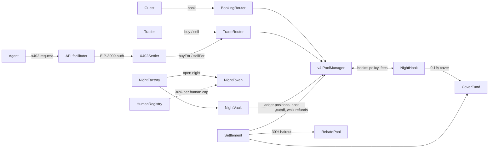

# Night Shares

Night Shares turns hotel room nights into tradable tokens on [Arc](https://arc.network), where gas and settlement are paid in USDC. Every room night (one property, one room type, one date) is its own ERC-20 `NightToken` with its own Uniswap v4 pool against USDC. The host's price curve is a ladder of liquidity positions in that pool, so the pool prices every trade and a hook enforces the rules. Guests book through a normal checkout, traders buy and sell nights before the stay, hosts get paid as rooms sell, and AI trading agents can trade on a user's behalf through x402 payments. Every participant is one human, verified with World ID.

Live app: <https://nightshares.dokploy.anshudhar.dev>

## Contents

- [How it works](#how-it-works)
- [Uniswap v4 integration](#uniswap-v4-integration)
- [Deployments](#deployments)
- [Built with Arc Studio](#built-with-arc-studio)
- [Architecture](#architecture)
- [Contracts](#contracts)
- [Quick start](#quick-start)
- [Security model and limits](#security-model-and-limits)
- [Docs](#docs)

## How it works

**Host.** A hotel opens a night with a floor price F, a curve steepness k and a room count S. `NightFactory` creates the night's `NightToken`, initializes its v4 pool and has `NightVault` add one liquidity position per room, so the price rises as rooms sell (P(q) = F·e^(kq/S)). All S tokens go into the pool at open, and F, k and S can never change afterwards. USDC that buyers paid for rooms below the current floor is swept to the host's payout address automatically. The host has no stop selling switch. To take rooms back it buys them through the pool like anyone else.

**Guest.** A guest books with `BookingRouter.buyAndRedeem`, which buys one room night (from the pool and from trader asks at or under the recall strike), then burns it in the same transaction. If the pool and asks are empty, the router recalls a room from the largest trader holder at the recall strike, so guests can always book while any room exists. A guest who is turned away at the desk (walked) reports it within 24 hours of check in. With a reception tag tap and no desk check in on record, the guest gets a full refund, paid from the host's unswept earnings, then from `CoverFund` as host debt.

**Trader.** Traders buy and sell through `TradeRouter`. Buys fill cheapest first across the pool and EIP-712 signed trader asks held by the API order book. Sells go back into the pool at its bid, with a late sell-back fee that grows toward the stay. Each human may hold at most 30% of a night's rooms (at least one), summed across every wallet they control, including their agents. At cutoff, `Settlement` freezes the pool and every unsold holder receives 70% of the pool bid for their held reserve. The 30% haircut funds `RebatePool`, which pays maker rebates on filled asks.

**Agents.** A trader can deploy AI trading agents with a budget and limits. A model writes the strategy, and plain code executes it. Every agent trade is an x402 paid HTTP request settled atomically on chain by `X402Settler` through EIP-3009 `transferWithAuthorization`: buys pay USDC, sells pay the night's `NightToken`, and the other leg returns in the same transaction or the whole thing reverts. Agent buys over 10 USDC on mainnet (100 USDC on testnet and the fork) need a fresh World ID check from the owner. Sells never do, because a sell only turns tokens back into USDC in the agent's own wallet, and holding an exit for approval could trap funds or push it into the late fee window.

**Fees.** Every buy pays 1.3% of notional in USDC, taken by `NightHook`: 1% to the host, 0.2% to the platform treasury, 0.1% to `CoverFund`. A host trading its own nights pays the full fee and its 1% share goes to `RebatePool`. The pool's own LP fee is zero.

**Identity and custody.** World ID gives one human one identity. Orb verification is required to trade, host or approve agent orders, and guest trust moments use a lighter credential. `HumanRegistry` maps wallets to the World ID nullifier and is written only by the API attester. User and agent wallets are Privy server wallets, so keys never reach the browser.



## Uniswap v4 integration

Each room night is a Uniswap v4 pool (NightToken/USDC, LP fee 0, tick spacing 1) with `NightHook` attached. The pool does all the pricing with standard concentrated liquidity math: the host's curve is a ladder of one liquidity position per room. The hook never replaces pricing; it enforces policy (allowed routers, World ID, pause, cutoff) and takes the 1.3% fee in USDC through return deltas. On Arc mainnet the contracts use the official Uniswap v4 PoolManager [`0x8366a39CC670B4001A1121B8F6A443A643e40951`](https://explorer.arc.io/address/0x8366a39CC670B4001A1121B8F6A443A643e40951).

Links point at commit `5551d69` (source identical to the mainnet deployment commit `dc30c82`).

| What | Code | What it does |
| --- | --- | --- |
| Hook permissions | [`NightHook.sol:88-97`](https://github.com/SlayerAnsh/night-shares/blob/5551d69ec2c5b1f007fd935eccd24d19bbf1d06e/packages/contracts/src/NightHook.sol#L88-L97) | Declares beforeInitialize, beforeAddLiquidity, beforeRemoveLiquidity, beforeSwap, afterSwap, beforeDonate, plus beforeSwapReturnDelta and afterSwapReturnDelta |
| Permission check at deploy | [`NightHook.sol:75`](https://github.com/SlayerAnsh/night-shares/blob/5551d69ec2c5b1f007fd935eccd24d19bbf1d06e/packages/contracts/src/NightHook.sol#L75) | `Hooks.validateHookPermissions` reverts unless the hook address carries exactly these flag bits |
| Pool initialization gate | [`NightHook.sol:99-121`](https://github.com/SlayerAnsh/night-shares/blob/5551d69ec2c5b1f007fd935eccd24d19bbf1d06e/packages/contracts/src/NightHook.sol#L99-L121) | `beforeInitialize`: only `NightFactory`, LP fee 0, tick spacing 1, NightToken/USDC pair |
| Liquidity gates | [`NightHook.sol:137-180`](https://github.com/SlayerAnsh/night-shares/blob/5551d69ec2c5b1f007fd935eccd24d19bbf1d06e/packages/contracts/src/NightHook.sol#L137-L180) | `beforeAddLiquidity` only from `NightVault`; `beforeRemoveLiquidity` only for host sweeps and cutoff |
| Router identity | [`NightHook.sol:182-190`](https://github.com/SlayerAnsh/night-shares/blob/5551d69ec2c5b1f007fd935eccd24d19bbf1d06e/packages/contracts/src/NightHook.sol#L182-L190) | Resolves the end user through the router's `msgSender()` (v4 periphery `IMsgSender` pattern); only the two routers are allowed |
| beforeSwap | [`NightHook.sol:236-277`](https://github.com/SlayerAnsh/night-shares/blob/5551d69ec2c5b1f007fd935eccd24d19bbf1d06e/packages/contracts/src/NightHook.sol#L236-L277) | Pause, cutoff and ladder checks, then takes the USDC fee with `manager.take` and returns it as a `BeforeSwapDelta` when USDC is the specified side |
| afterSwap fee delta | [`NightHook.sol:279-310`](https://github.com/SlayerAnsh/night-shares/blob/5551d69ec2c5b1f007fd935eccd24d19bbf1d06e/packages/contracts/src/NightHook.sol#L279-L310) | When USDC is the unspecified side, takes the fee and returns it as the `afterSwap` int128 delta; emits the Trade event |
| Donations blocked | [`NightHook.sol:312-314`](https://github.com/SlayerAnsh/night-shares/blob/5551d69ec2c5b1f007fd935eccd24d19bbf1d06e/packages/contracts/src/NightHook.sol#L312-L314) | `beforeDonate` always reverts |
| Pool key | [`NightFactory.sol:87-91`](https://github.com/SlayerAnsh/night-shares/blob/5551d69ec2c5b1f007fd935eccd24d19bbf1d06e/packages/contracts/src/NightFactory.sol#L87-L91) | `PoolKey(NightToken, USDC, fee 0, tickSpacing 1, NightHook)` |
| Pool initialization | [`NightFactory.sol:173-203`](https://github.com/SlayerAnsh/night-shares/blob/5551d69ec2c5b1f007fd935eccd24d19bbf1d06e/packages/contracts/src/NightFactory.sol#L173-L203) | `openNight` checks mainnet limits and token order (NightToken sorts below USDC so it is `currency0`), then calls `PoolManager.initialize` |
| Ladder seeding | [`NightFactory.sol:222-231`](https://github.com/SlayerAnsh/night-shares/blob/5551d69ec2c5b1f007fd935eccd24d19bbf1d06e/packages/contracts/src/NightFactory.sol#L222-L231), [`NightVault.sol:115-124`](https://github.com/SlayerAnsh/night-shares/blob/5551d69ec2c5b1f007fd935eccd24d19bbf1d06e/packages/contracts/src/NightVault.sol#L115-L124) | `addLadderChunk` adds rooms to the ladder in chunks of up to 10 |
| Liquidity callback | [`NightVault.sol:203-245`](https://github.com/SlayerAnsh/night-shares/blob/5551d69ec2c5b1f007fd935eccd24d19bbf1d06e/packages/contracts/src/NightVault.sol#L203-L245) | `NightVault` unlocks the PoolManager and calls `modifyLiquidity` once per room, then settles with `sync`/`settle`/`take` |
| Ladder positions | [`NightPosition.sol:18-33`](https://github.com/SlayerAnsh/night-shares/blob/5551d69ec2c5b1f007fd935eccd24d19bbf1d06e/packages/contracts/src/libraries/NightPosition.sol#L18-L33), [`LadderMath.sol:32-56`](https://github.com/SlayerAnsh/night-shares/blob/5551d69ec2c5b1f007fd935eccd24d19bbf1d06e/packages/contracts/src/libraries/LadderMath.sol#L32-L56) | Tick-snapped range and liquidity per room from the curve P(q) = F·e^(kq/S), using v4 `TickMath` and `SqrtPriceMath` |
| TradeRouter unlock | [`TradeRouter.sol:111-119`](https://github.com/SlayerAnsh/night-shares/blob/5551d69ec2c5b1f007fd935eccd24d19bbf1d06e/packages/contracts/src/TradeRouter.sol#L111-L119), [`TradeRouter.sol:364-366`](https://github.com/SlayerAnsh/night-shares/blob/5551d69ec2c5b1f007fd935eccd24d19bbf1d06e/packages/contracts/src/TradeRouter.sol#L364-L366) | Buys and sells call `poolManager.unlock`; `unlockCallback` runs the swap |
| TradeRouter swap, settle, take | [`TradeRouter.sol:148-216`](https://github.com/SlayerAnsh/night-shares/blob/5551d69ec2c5b1f007fd935eccd24d19bbf1d06e/packages/contracts/src/TradeRouter.sol#L148-L216) | Pre-settles USDC, calls `poolManager.swap` with exact output token amounts, then settles the input and takes the output |
| BookingRouter swap path | [`BookingRouter.sol:32-34`](https://github.com/SlayerAnsh/night-shares/blob/5551d69ec2c5b1f007fd935eccd24d19bbf1d06e/packages/contracts/src/BookingRouter.sol#L32-L34), [`BookingRouter.sol:52-74`](https://github.com/SlayerAnsh/night-shares/blob/5551d69ec2c5b1f007fd935eccd24d19bbf1d06e/packages/contracts/src/BookingRouter.sol#L52-L74) | Guest booking: pool and ask route through the shared router core (same unlock callback), recall if needed, burn |
| Cutoff redemption swap | [`Settlement.sol:197-226`](https://github.com/SlayerAnsh/night-shares/blob/5551d69ec2c5b1f007fd935eccd24d19bbf1d06e/packages/contracts/src/Settlement.sol#L197-L226) | `Settlement` swaps held tokens back into the pool at cutoff and takes the USDC reserve |
| Permit2 | [`TradeRouter.sol:81-87`](https://github.com/SlayerAnsh/night-shares/blob/5551d69ec2c5b1f007fd935eccd24d19bbf1d06e/packages/contracts/src/TradeRouter.sol#L81-L87), [`TradeRouter.sol:170-172`](https://github.com/SlayerAnsh/night-shares/blob/5551d69ec2c5b1f007fd935eccd24d19bbf1d06e/packages/contracts/src/TradeRouter.sol#L170-L172) | Taker USDC is pulled with Permit2 `AllowanceTransfer.transferFrom`; the allowance and expiry are checked before pre-settling |
| Hook address mining | [`DeployLib.sol:44-52`](https://github.com/SlayerAnsh/night-shares/blob/5551d69ec2c5b1f007fd935eccd24d19bbf1d06e/packages/contracts/script/DeployLib.sol#L44-L52) | Brute-forces a CREATE2 salt until the low 14 address bits equal `0x2aec`, the flag bits of the permissions above |
| HookDeployer | [`DeployLib.sol:91-100`](https://github.com/SlayerAnsh/night-shares/blob/5551d69ec2c5b1f007fd935eccd24d19bbf1d06e/packages/contracts/script/DeployLib.sol#L91-L100) | Deploys `NightHook` with that salt via `create2` |
| PoolManager config | [`Deploy.s.sol:11-13`](https://github.com/SlayerAnsh/night-shares/blob/5551d69ec2c5b1f007fd935eccd24d19bbf1d06e/packages/contracts/script/Deploy.s.sol#L11-L13) | PoolManager and Permit2 addresses come from deploy config, never hard coded |

Developer feedback on building with Uniswap v4 on Arc: [`FEEDBACK.md`](FEEDBACK.md). It is also linked from the Uniswap developer feedback form submission.

## Deployments

Addresses below are copied from the deployment records in [`packages/contracts/deployments`](packages/contracts/deployments). Those JSON files (with full ABIs and constructor configuration) are the source of truth.

### Arc mainnet (chain 5042)

Record: [`5042.json`](packages/contracts/deployments/5042.json). Deployed at block 29940574 from commit `dc30c82`, against the official Uniswap v4 PoolManager [`0x8366a39CC670B4001A1121B8F6A443A643e40951`](https://explorer.arc.io/address/0x8366a39CC670B4001A1121B8F6A443A643e40951). Explorer: <https://explorer.arc.io>.

Safety limits (immutable in `NightFactory`): `MAX_F` 1 USDC floor price per room night, `MAX_POOL` 50 USDC full ladder cost per night, `MAX_S` 100 rooms per night, `MAX_OPEN_NIGHTS` 20 unsettled nights. Total exposure is therefore at most 1,000 USDC.

Source verification on the explorer is run with `sh packages/contracts/script/verify-deployment.sh` (added in commit `5551d69`), from `packages/contracts` at the deployed commit. Check each address on the explorer for its current verification status.

| Contract | Address |
| --- | --- |
| NightFactory | [`0x27Ac91359A3430C7b8C4010c147E7A8942A9e1bc`](https://explorer.arc.io/address/0x27Ac91359A3430C7b8C4010c147E7A8942A9e1bc) |
| NightHook | [`0x868f2BCd2B3FA4B81d88523477f17879c5Dd2aEc`](https://explorer.arc.io/address/0x868f2BCd2B3FA4B81d88523477f17879c5Dd2aEc) |
| NightVault | [`0xF4A8357959464624b184E49f4D540BcA9b62b18a`](https://explorer.arc.io/address/0xF4A8357959464624b184E49f4D540BcA9b62b18a) |
| TradeRouter | [`0x69C68EEC250299b7220A128dB8143B9894cd92a6`](https://explorer.arc.io/address/0x69C68EEC250299b7220A128dB8143B9894cd92a6) |
| BookingRouter | [`0x53fD4D595bF06bB80451A8545C51f1C2fcc19CBB`](https://explorer.arc.io/address/0x53fD4D595bF06bB80451A8545C51f1C2fcc19CBB) |
| Settlement | [`0x56411402929cA8a55513A25E0BB4e61cB78e9a1a`](https://explorer.arc.io/address/0x56411402929cA8a55513A25E0BB4e61cB78e9a1a) |
| CoverFund | [`0x46a375412474AE190f6F5F4B9c61196760bbC48F`](https://explorer.arc.io/address/0x46a375412474AE190f6F5F4B9c61196760bbC48F) |
| RebatePool | [`0xC1b9e2C664DA6526C1070181E3Ca48562ffd9B1c`](https://explorer.arc.io/address/0xC1b9e2C664DA6526C1070181E3Ca48562ffd9B1c) |
| HumanRegistry | [`0x5B4c1195a5a0B9742EC7a637F1d54063F85F4386`](https://explorer.arc.io/address/0x5B4c1195a5a0B9742EC7a637F1d54063F85F4386) |
| X402Settler | [`0xB64c36EC2935643aE622791C8D5f25b815B5ED31`](https://explorer.arc.io/address/0xB64c36EC2935643aE622791C8D5f25b815B5ED31) |
| NightTokenDeployer | [`0x59E8a7b8a9ddf591Ed892ECa06C26763E423d5Bc`](https://explorer.arc.io/address/0x59E8a7b8a9ddf591Ed892ECa06C26763E423d5Bc) |
| HookDeployer | [`0xca6404429921F8F2D3815Ce573a5f52241100d39`](https://explorer.arc.io/address/0xca6404429921F8F2D3815Ce573a5f52241100d39) |
| Uniswap v4 PoolManager | [`0x8366a39CC670B4001A1121B8F6A443A643e40951`](https://explorer.arc.io/address/0x8366a39CC670B4001A1121B8F6A443A643e40951) |
| USDC | [`0x3600000000000000000000000000000000000000`](https://explorer.arc.io/address/0x3600000000000000000000000000000000000000) |
| Permit2 | [`0x000000000022D473030F116dDEE9F6B43aC78BA3`](https://explorer.arc.io/address/0x000000000022D473030F116dDEE9F6B43aC78BA3) |
| Owner (pause) | [`0x712304ed163a2021Bc179d81E6F1bBAa64AE338a`](https://explorer.arc.io/address/0x712304ed163a2021Bc179d81E6F1bBAa64AE338a) |
| Platform (fee recipient) | [`0x890a49C20aba01E020AD7d334dAEeD1C4b78f854`](https://explorer.arc.io/address/0x890a49C20aba01E020AD7d334dAEeD1C4b78f854) |
| Attester | [`0xaeCdDC573e77e23DA449Ab4184Ac81a1c960fec4`](https://explorer.arc.io/address/0xaeCdDC573e77e23DA449Ab4184Ac81a1c960fec4) |
| Deployer | [`0xEfD0195458C9CDd99178D92404f09a04f8863b90`](https://explorer.arc.io/address/0xEfD0195458C9CDd99178D92404f09a04f8863b90) |

### Arc testnet (chain 5042002), current

Record: [`5042002.json`](packages/contracts/deployments/5042002.json). The current testnet set, with x402 (`X402Settler`, EIP-3009 on `NightToken`), deployed at block 71125353 from commit `5801bf6`. It uses the same mainnet limits. Explorer: <https://testnet.arcscan.app> (also <https://explorer.testnet.arc.io>).

| Contract | Address |
| --- | --- |
| NightFactory | [`0x9D7ecCe48bFd60c1Aae7DB831EBd6A1e6eaA3FdC`](https://testnet.arcscan.app/address/0x9D7ecCe48bFd60c1Aae7DB831EBd6A1e6eaA3FdC) |
| NightHook | [`0xf36A6AD3ef9B5081a9cC4F167a662D7D88D1eaEc`](https://testnet.arcscan.app/address/0xf36A6AD3ef9B5081a9cC4F167a662D7D88D1eaEc) |
| NightVault | [`0x4dE0DB0Dd4D1D03142a032CdabF0Dda96D111546`](https://testnet.arcscan.app/address/0x4dE0DB0Dd4D1D03142a032CdabF0Dda96D111546) |
| TradeRouter | [`0x6CF1B089539Fba9E165d335F2E124C924e834a77`](https://testnet.arcscan.app/address/0x6CF1B089539Fba9E165d335F2E124C924e834a77) |
| BookingRouter | [`0x3552db63FDAeEe4EeBFbC0E6D64bA7455b299Fc4`](https://testnet.arcscan.app/address/0x3552db63FDAeEe4EeBFbC0E6D64bA7455b299Fc4) |
| Settlement | [`0xD3dEDdFeb6EE6DDE4c739f70b6216f0Eca0E29d4`](https://testnet.arcscan.app/address/0xD3dEDdFeb6EE6DDE4c739f70b6216f0Eca0E29d4) |
| CoverFund | [`0xC66FF3f1F8c3284E3B5F123777b84c130B8A2314`](https://testnet.arcscan.app/address/0xC66FF3f1F8c3284E3B5F123777b84c130B8A2314) |
| RebatePool | [`0xFcF9b1a7f99e00e583d43d7dA0DAf16D61320935`](https://testnet.arcscan.app/address/0xFcF9b1a7f99e00e583d43d7dA0DAf16D61320935) |
| HumanRegistry | [`0x19540Bb5A6B9A259e67816af1A200c920A69eC0F`](https://testnet.arcscan.app/address/0x19540Bb5A6B9A259e67816af1A200c920A69eC0F) |
| X402Settler | [`0x7a4FDea6E1A10312fb8D88c49d9DCaFE82F795fC`](https://testnet.arcscan.app/address/0x7a4FDea6E1A10312fb8D88c49d9DCaFE82F795fC) |
| NightTokenDeployer | [`0x9bDdECE2d9A00423055687E8699d303514014a76`](https://testnet.arcscan.app/address/0x9bDdECE2d9A00423055687E8699d303514014a76) |
| HookDeployer | [`0xD501b460567E57B30FcF11ad35B85Ad6259aC964`](https://testnet.arcscan.app/address/0xD501b460567E57B30FcF11ad35B85Ad6259aC964) |
| Demo NightToken | [`0x1BFE065De8f26F9894098b9E9D362C72cAEb8433`](https://testnet.arcscan.app/address/0x1BFE065De8f26F9894098b9E9D362C72cAEb8433) |
| Uniswap v4 PoolManager | [`0x8366a39CC670B4001A1121B8F6A443A643e40951`](https://testnet.arcscan.app/address/0x8366a39CC670B4001A1121B8F6A443A643e40951) |
| USDC | [`0x3600000000000000000000000000000000000000`](https://testnet.arcscan.app/address/0x3600000000000000000000000000000000000000) |
| Permit2 | [`0x000000000022D473030F116dDEE9F6B43aC78BA3`](https://testnet.arcscan.app/address/0x000000000022D473030F116dDEE9F6B43aC78BA3) |
| Owner (pause) | [`0xbaedDFc6122C5b873ebcE221a91E94789Ab82Ca3`](https://testnet.arcscan.app/address/0xbaedDFc6122C5b873ebcE221a91E94789Ab82Ca3) |
| Platform (fee recipient) | [`0xbaedDFc6122C5b873ebcE221a91E94789Ab82Ca3`](https://testnet.arcscan.app/address/0xbaedDFc6122C5b873ebcE221a91E94789Ab82Ca3) |
| Attester | [`0x485814367d4D7aB3330cc33398474993834441ec`](https://testnet.arcscan.app/address/0x485814367d4D7aB3330cc33398474993834441ec) |
| Deployer | [`0x60C8e3847Da87F37536ccD07D91c2289693d2F1b`](https://testnet.arcscan.app/address/0x60C8e3847Da87F37536ccD07D91c2289693d2F1b) |

### Arc testnet (chain 5042002), first deployment

Record: [`5042002-v1.json`](packages/contracts/deployments/5042002-v1.json). The first testnet set, before x402, deployed at block 71115581 with Arc Studio (see below). It runs on its own PoolManager [`0x09586E643989B9C7273F8A4bA1D47163F0B17C69`](https://testnet.arcscan.app/address/0x09586E643989B9C7273F8A4bA1D47163F0B17C69).

| Contract | Address |
| --- | --- |
| NightFactory | [`0x571A92D4Aa761C98De25a7319fF40B08354801e0`](https://testnet.arcscan.app/address/0x571A92D4Aa761C98De25a7319fF40B08354801e0) |
| NightHook | [`0x065b256B4AfAa7638f6647bD5125417974B02AEC`](https://testnet.arcscan.app/address/0x065b256B4AfAa7638f6647bD5125417974B02AEC) |
| NightVault | [`0x4340425dd550bf4Bd168f16C27212e5C20b3eB19`](https://testnet.arcscan.app/address/0x4340425dd550bf4Bd168f16C27212e5C20b3eB19) |
| TradeRouter | [`0xCc0494037065fF7Aee73a65302b25251AB6907f8`](https://testnet.arcscan.app/address/0xCc0494037065fF7Aee73a65302b25251AB6907f8) |
| BookingRouter | [`0x38501e047c83929a18B3D1E6ed5E61Df5c6366fC`](https://testnet.arcscan.app/address/0x38501e047c83929a18B3D1E6ed5E61Df5c6366fC) |
| Settlement | [`0xEd2d5D23cEEF3202a98fB03240254955f6373a16`](https://testnet.arcscan.app/address/0xEd2d5D23cEEF3202a98fB03240254955f6373a16) |
| CoverFund | [`0xD217aCdd3Ca9A185e849E7d0F13d0a5F7F14acDF`](https://testnet.arcscan.app/address/0xD217aCdd3Ca9A185e849E7d0F13d0a5F7F14acDF) |
| RebatePool | [`0xb03146d8ED3038B1044568D4bE62990933Db6030`](https://testnet.arcscan.app/address/0xb03146d8ED3038B1044568D4bE62990933Db6030) |
| HumanRegistry | [`0x364e22DA4e82c7B98F8eFF9e545800055B012bC6`](https://testnet.arcscan.app/address/0x364e22DA4e82c7B98F8eFF9e545800055B012bC6) |
| HookDeployer | [`0x508C4079f57AA14c594CA33220B0f763E327a4fa`](https://testnet.arcscan.app/address/0x508C4079f57AA14c594CA33220B0f763E327a4fa) |
| Uniswap v4 PoolManager | [`0x09586E643989B9C7273F8A4bA1D47163F0B17C69`](https://testnet.arcscan.app/address/0x09586E643989B9C7273F8A4bA1D47163F0B17C69) |
| USDC | [`0x3600000000000000000000000000000000000000`](https://testnet.arcscan.app/address/0x3600000000000000000000000000000000000000) |
| Permit2 | [`0x000000000022D473030F116dDEE9F6B43aC78BA3`](https://testnet.arcscan.app/address/0x000000000022D473030F116dDEE9F6B43aC78BA3) |
| Owner (pause) | [`0xbaedDFc6122C5b873ebcE221a91E94789Ab82Ca3`](https://testnet.arcscan.app/address/0xbaedDFc6122C5b873ebcE221a91E94789Ab82Ca3) |
| Platform (fee recipient) | [`0xbaedDFc6122C5b873ebcE221a91E94789Ab82Ca3`](https://testnet.arcscan.app/address/0xbaedDFc6122C5b873ebcE221a91E94789Ab82Ca3) |
| Attester | [`0x485814367d4D7aB3330cc33398474993834441ec`](https://testnet.arcscan.app/address/0x485814367d4D7aB3330cc33398474993834441ec) |
| Deployer | [`0x60C8e3847Da87F37536ccD07D91c2289693d2F1b`](https://testnet.arcscan.app/address/0x60C8e3847Da87F37536ccD07D91c2289693d2F1b) |

## Built with Arc Studio

The first testnet deployment ([`5042002-v1.json`](packages/contracts/deployments/5042002-v1.json)) was built, deployed and source verified with [Arc Studio](https://studio.arc.io/app/4375399a-9c40-4d29-9dd0-72d772703be5).

- Studio deployed a Uniswap v4 PoolManager natively, then ran the Foundry deploy script ([`Deploy.s.sol`](packages/contracts/script/Deploy.s.sol)) in its sandbox against it.
- 10 of the 11 contracts are fully source verified on Blockscout. The PoolManager is partially verified (bytecode match, metadata differs).
- Arc Studio supports Arc testnet only (deploy, import and verification). The current testnet x402 set and the mainnet deployment were therefore deployed from a local terminal with encrypted Foundry keystores, using the same contracts and the same deploy script.

## Architecture

pnpm workspace. TypeScript everywhere, Bun for the API, Next.js for the web app, Foundry for contracts. Protobuf is the single API contract.

```
apps/
  api/              Bun + Connect server: identity, catalog, stay, market, host, wallet,
                    agents and the x402 facilitator; chain executor, reader and attester
  web/              Next.js app with three areas: Stay (guests), Trade (traders, agents), Host
packages/
  contracts/        Solidity contracts, Foundry tests, deploy and verify scripts, deployment records
  market-model/     pure pricing, ladder, order book and payout math shared by API and web
  proto/            .proto sources with generated TypeScript, Connect Query hooks and OpenAPI
  design-system/    design tokens, base CSS and React primitives for the web app
  tsconfig/         shared tsconfig presets
docs/               design specs
```

Every external system (World ID, wallet custody, chain, hotel system, reception tags) sits behind a port with a mock adapter, so the whole product runs on mocks and real adapters replace them one at a time. Hotel inventory and rates come from your hotel system through the channel manager port. With `ARC_NETWORK=fork`, `testnet` or `mainnet` the API runs on chain: a durable transaction journal, Privy signing, gas funding of user wallets from an ops wallet, and block polling that rebuilds state from contract events.

Package docs: [`apps/api`](apps/api/README.md), [`apps/web`](apps/web/README.md), [`packages/contracts`](packages/contracts/README.md), [`packages/market-model`](packages/market-model/README.md), [`packages/proto`](packages/proto/README.md), [`packages/design-system`](packages/design-system/README.md).

## Contracts

Full call graph, access rules, function inventory and pause matrix: [`packages/contracts/CONTRACTS.md`](packages/contracts/CONTRACTS.md).

| Contract | Role |
| --- | --- |
| `NightFactory` | Opens nights: deploys the `NightToken`, initializes the pool, seeds the ladder, enforces the mainnet limits |
| `NightToken` | ERC-20 per night (18 decimals, whole tenths only). Enforces the 30% per human cap, keeps the holder list for recall, supports EIP-3009 |
| `NightHook` | Uniswap v4 hook. Allows only the two routers, checks World ID, takes fees in USDC, blocks swaps after cutoff, owner pause |
| `NightVault` | Owns all ladder positions, has no admin, sweeps earned USDC to the host |
| `TradeRouter` | Trader buys and sells across the pool and signed asks (Permit2 for USDC), plus settler only `buyFor` and `sellFor` |
| `BookingRouter` | Guest booking: buy, recall if needed, burn, in one transaction |
| `Settlement` | Cutoff redemption into the pool with batched payouts and `claim` fallback, attester signed walk refunds |
| `CoverFund` | Receives 0.1% of each trade, advances walk refunds as host debt |
| `RebatePool` | Receives late fees and cutoff haircuts, pays maker rebates |
| `HumanRegistry` | Wallet to World ID mapping (Orb and guest tiers), walk bans |
| `X402Settler` | Atomic x402 settlement for agents. No owner, no pause, no withdraw |
| `NightTokenDeployer`, `HookDeployer` | CREATE2 helpers (token address mined to sort below USDC, hook address mined for its permission bits) |

## Quick start

Requirements: Node 22, pnpm 10, Bun 1.2, Docker, and Foundry for contract work. Full instructions, environment keys and chain modes are in [`DEVELOPER.md`](DEVELOPER.md).

Run on mocks:

```sh
pnpm install
pnpm --filter @night-shares/api dev    # API on http://localhost:8787, Swagger UI at /docs
pnpm --filter @night-shares/web dev    # web on http://localhost:3000
```

Run against a local Anvil fork of Arc mainnet (real PoolManager and Permit2):

```sh
docker compose -f docker-compose.chain.yml up -d    # fork plus contract deploy, writes 5042-fork.json
cd apps/api && pnpm seed:fork                        # funds test wallets, opens three nights
pnpm dev:fork                                        # API on the fork (see DEVELOPER.md for env)
cd apps/web && pnpm dev                              # then open http://localhost:3000/trade
```

Contracts:

```sh
cd packages/contracts
sh script/install-deps.sh
forge test --offline
```

Checks before a commit: `pnpm gen`, `pnpm check`, `pnpm typecheck`, `pnpm test`.

Deployment: the live app runs on Dokploy, one Compose service per network, from [`docker-compose.mainnet.yml`](docker-compose.mainnet.yml) and [`docker-compose.testnet.yml`](docker-compose.testnet.yml). The network is chosen by each deployment's environment (`ARC_NETWORK` and related keys). See the Dokploy section of [`DEVELOPER.md`](DEVELOPER.md).

## Security model and limits

- **Unaudited.** The contracts have had no human or third party audit. They are covered by the Foundry suite and internal review passes. Treat the mainnet deployment as a capped pilot.
- **Bounded exposure.** On mainnet, every night costs at most 50 USDC to buy out and at most 20 nights can be open, so total value at risk is at most 1,000 USDC. There is no per trade cap.
- **Trusted attester.** The API's attester key signs wallet to World ID links, property ownership bindings and walked guest reports. This is a trusted operator role.
- **Exits stay open.** The owner can pause the hook globally or a single night. Pause blocks buys, sell-backs, ask fills, bookings, transfers between different humans and new openings. It never blocks burns, cutoff settlement, batched payouts, `claim`, host sweeps or walk refunds. Pause cannot move reserves or change endpoints.
- **No host bond.** Hosts lock nothing beyond the traded nights. Walk refunds come from the host's unswept earnings, then `CoverFund` as host debt netted from future payouts. Two walk incidents stop a host from opening new nights.
- **Routing is closed.** The hook accepts swaps only from `BookingRouter` and `TradeRouter`, so aggregators cannot route into night pools. This is what makes the World ID cap and guest recall enforceable.
- **Accepted x402 limitation.** A USDC authorization submitted directly to USDC instead of through `X402Settler` lands in the settler and cannot be recovered. The API facilitator only broadcasts authorizations inside settler calls. Details in [`CONTRACTS.md`](packages/contracts/CONTRACTS.md#accepted-limitation-for-direct-payments).
- **Mainnet API is read only by default.** The API refuses chain sends on mainnet unless `CHAIN_EXECUTION=on` is set explicitly.

## Docs

| Document | What it covers |
| --- | --- |
| [`SPECS.md`](SPECS.md) | What the system does: services, market rules, chain design, walked guest rule |
| [`DEVELOPER.md`](DEVELOPER.md) | How to run, test and deploy: environment, chain networks, fork, Dokploy |
| [`STANDARDS.md`](STANDARDS.md) | Coding standards for every package |
| [`CHANGELOG.md`](CHANGELOG.md) | What changed |
| [`packages/contracts/CONTRACTS.md`](packages/contracts/CONTRACTS.md) | Contract system reference |
| [`packages/contracts/README.md`](packages/contracts/README.md) | Contract tests, fork deploy, mainnet deploy |
| [`docs/superpowers/specs/2026-11-07-x402-agents-design.md`](docs/superpowers/specs/2026-11-07-x402-agents-design.md) | x402 trading agents design |
